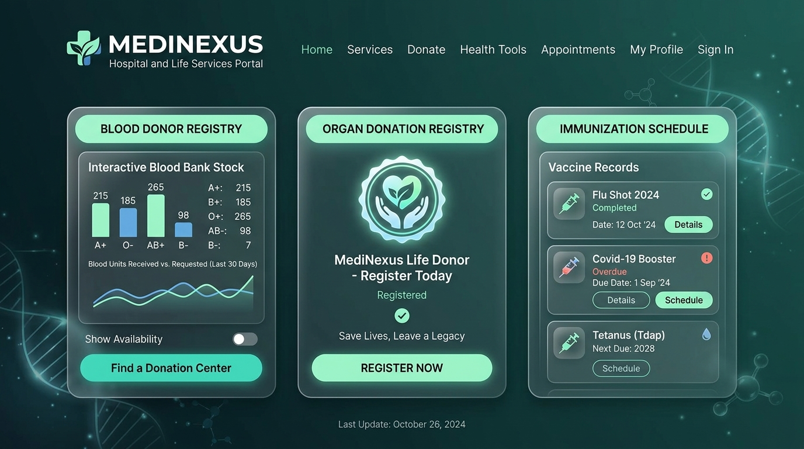

# 🏥 MediNexus — Hospital & Life Services Platform

[](LICENSE)
[](https://ANDY0802X.github.io/MediNexus-Hospital-LifeCare/)
[](https://developer.mozilla.org/en-US/docs/Web/HTML)
[](https://developer.mozilla.org/en-US/docs/Web/CSS)
[](https://developer.mozilla.org/en-US/docs/Web/JavaScript)

**MediNexus** is a modern, unified web portal designed to coordinate critical life-saving healthcare operations. Moving far beyond traditional hospital directories, MediNexus integrates **24/7 Blood Bank Management**, **Organ & Tissue Donation Registry**, **Vaccination & Immunization Hub**, and **Specialist Doctor Consultations** into a seamless, interactive patient and donor experience.

---

## 🌟 Visual Showcase



---

## 🚀 Core Modules & Capabilities

### 1. 🩸 Blood Bank & Donor Match
- **Real-Time Inventory Dashboard**: Live tracking of available blood units across all 8 major blood groups ($A^+$, $A^-$, $B^+$, $B^-$, $O^+$, $O^-$, $AB^+$, $AB^-$) with dynamic status indicators (*Available*, *Low Stock*, *Critical*).
- **Donor Registration Portal**: Enables prospective donors to sign up for blood drives and schedule donation appointments.
- **Emergency Blood Requisition**: Instant emergency request workflow for rapid hospital-to-bank triage.

### 2. 🫀 Organ & Tissue Donation Registry
- **National Pledge Registry**: Secure and legally compliant pledge registration for organ donors.
- **Multi-Organ Support**: Organ donation tracking and education across **Heart, Lungs, Kidneys, Liver, Cornea (Sight Restoration), and Bone Marrow/Stem Cells**.
- **Donor Impact Awareness**: Direct transparency metrics (over 12,850+ registered pledges saving countless lives).

### 3. 💉 Vaccination & Immunization Hub
- **Universal Immunization Coverage**: Complete schedules for childhood vaccines (MMR, Polio, DTaP, Hepatitis B) and adult annual boosters (COVID-19, Influenza 2026, Tdap).
- **Travel Vaccine Center**: Specialized travel immunizations (Yellow Fever, Typhoid, Meningococcal) with verifiable health documentation.
- **Slot Booking**: Interactive scheduling system for vaccination appointments.

### 4. 🩺 Specialist Doctor Directory & Appointments
- **Multi-Department Consultations**: Direct appointment booking with board-certified specialists in Cardiology, Transplant Nephrology, Hematology, and Pediatrics.
- **Live Availability Badges**: Real-time indication of doctor schedules.

### 5. 🚨 24/7 Emergency & Ambulance Dispatch
- **Instant Hotline & Ambulance Trigger**: Dedicated emergency telephone channels (`+91 8619216569`) and rapid response dispatch.

### 6. 🎨 Interactive Claymorphism UI & Scroll-Driven Canvas
- **Dynamic Scroll Animation**: Responsive HTML5 Canvas sequence rendering animated physician illustrations synchronized with viewport scroll depth.
- **Accessible Modals & Toast Feedback**: Zero-dependency interactive popups for booking, donating, and pledging.

---

## 📁 Repository Structure

```text
├── .github/
│   └── workflows/
│       └── deploy.yml          # GitHub Pages CI/CD deployment
├── assets/
│   ├── favicon.svg             # Medical cross & pulse SVG favicon
│   ├── img/
│   │   ├── doc_full.png        # Lead doctor portrait
│   │   ├── doc_half.png        # Avatar badge asset
│   │   ├── social_preview.png  # OpenGraph & GitHub showcase banner
│   │   ├── docs/               # Specialist doctor portraits
│   │   └── frames_mine/        # 87-frame scroll animation sequence
│   └── vid/
│       └── female_doc_moving.mp4
├── css/
│   ├── style.css               # Design system, theme variables & clay cards
│   ├── home.css                # Layouts, modules (Blood, Organ, Vax), modals
│   └── login.css               # Authentication portal styles
├── html/
│   ├── login_page.html         # Role-based login (Patient/Donor/Doctor)
│   └── sign_up.html            # Registration form for new patients and donors
├── js/
│   └── home.js                 # Scroll canvas engine, modal & form handlers
├── .gitignore                  # Git exclusions
├── LICENSE                     # MIT Open Source License
├── index.html                  # Main application portal
└── README.md                   # Project documentation
```

---

## 🛠️ Tech Stack

- **Markup & Semantics**: HTML5 with OpenGraph & Twitter Card SEO metadata
- **Styling**: Vanilla CSS3 (Custom Properties, Claymorphism, Clamp-based Responsive Typography, CSS Grid & Flexbox)
- **Scripting**: Pure Vanilla JavaScript (ES6+, HTML5 2D Canvas context rendering, Scroll-linked frame interpolation)
- **Deployment**: GitHub Pages via GitHub Actions

---

## 💻 Getting Started Locally

No complex build steps or node packages required!

### 1. Clone the repository
```bash
git clone https://github.com/ANDY0802X/MediNexus-Hospital-LifeCare.git
cd MediNexus-Hospital-LifeCare
```

### 2. Run locally
Open `index.html` directly in your browser, or start a local lightweight web server:

```bash
# Using Python
python -m http.server 3000

# Using Node / npx
npx serve .
```

Visit `http://localhost:3000` in your web browser.

---

## 📄 License

Distributed under the [MIT License](LICENSE). Feel free to use and adapt this project for educational and healthcare management applications.
