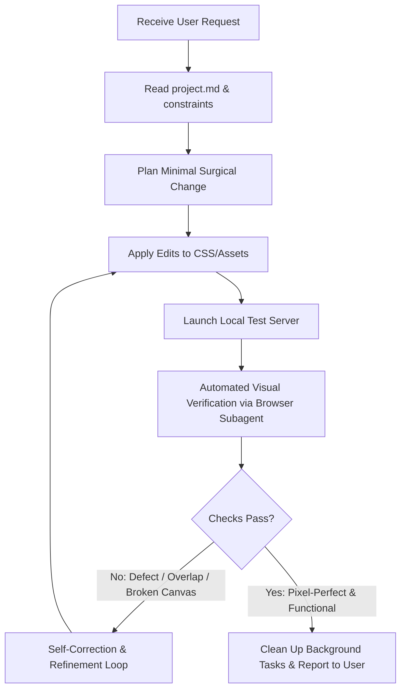

# 🤖 AI Agent Engineering Directives (`instructions.md`)

This guide outlines mandatory operating rules and verification loops for **every AI agent** working on the `MediNexus-Hospital-LifeCare` repository.

---

## 1. Prime Directives (Non-Negotiable)

1. **Architecture Invariance**:
   - **Do not modify HTML markup architecture** (`index.html`) unless the user explicitly uses words like *"restructure the HTML"* or *"rebuild the markup"*.
   - Never replace existing tags, rename IDs/classes, change text copy, or reorganize components.
2. **Preserve Canvas & Scroll Engine**:
   - The female doctor canvas animation (`#docCanvas`) and `#scrollStage` scroll engine **must remain active and operational at all times**, regardless of viewport width or browser type.
   - Never inject `display: none` or remove `.scroll-stage::after` height.
3. **Surgical, Targeted Edits**:
   - If the user asks for a **color scheme change**, modify **only** color properties (`color`, `background`, `border-color`, `box-shadow`, `fill`, `stroke`) in the CSS files.
   - Do not alter layout geometry (`position: sticky`, `height: 80vh`, `overflow-y: auto`) under the guise of styling.

---

## 2. Iterative Development & Quality Loop
*You must iterate and self-validate until the solution achieves peak fidelity before reporting completion.*



### Iteration Protocol:
1. **Pre-flight Check**: Check `git status` and `git diff` before modifying anything. Know your baseline.
2. **Surgical Implementation**: Apply changes with minimal footprint.
3. **Multi-Viewport Visual Inspection**:
   - **Desktop (1280x800)**: Verify header, connected containers, dual-doctor composition, scroll canvas, and doctor cards.
   - **Tablet (768x1024)**: Verify that elements do not collide and canvas remains active.
   - **Mobile (375x667 to 500x700)**: Verify that the scroll stage behaves properly and text is legible.
4. **Interactive Validation**:
   - Scroll `#scrollStage` and verify that the canvas frames interpolate cleanly.
   - Move the mouse over the male doctor to ensure the tilt effect functions.
5. **Self-Correction Requirement**:
   - If any visual glitch, unwanted overflow, or disabled canvas is detected, **do not stop**—iterate and repair immediately before presenting the result to the user.

---

## 3. Cross-Browser Color & Styling Principles

When crafting or adjusting color schemes:
- **Use CSS Custom Properties (`:root`)** when appropriate for color tokens, but preserve the fallback values.
- **Support Both WebKit and Gecko Scrollbars**:
  ```css
  /* WebKit (Chrome, Safari, Edge) */
  .scroll-stage::-webkit-scrollbar { width: 10px; }
  .scroll-stage::-webkit-scrollbar-thumb { background: #174b57; border-radius: 8px; }
  
  /* Gecko (Firefox) */
  * { scrollbar-width: thin; scrollbar-color: #174b57 #dcebea; }
  ```
- **Ensure High WCAG Contrast**:
  - Dark text on light cards (`#183b43` on `#ffffff` or `#edf6f4`).
  - White text on dark headers (`#ffffff` on `#174b57`).
- **Surface Elevation**: Maintain the Claymorphism aesthetic (`.clay-card`) using subtle outer borders (`#d6e6e3`) and multi-stop ambient drop shadows.

---

## 4. Communication & Transparency Standards
- Always link to modified files using clickable markdown links (e.g., [style.css](file:///d:/CODING/web%20dev/labs_DBMS/Project_claude/css/style.css)).
- If an instruction is ambiguous, prioritize keeping existing behavior over making sweeping assumptions.
- If a regression occurs, own it immediately and revert cleanly via Git.
